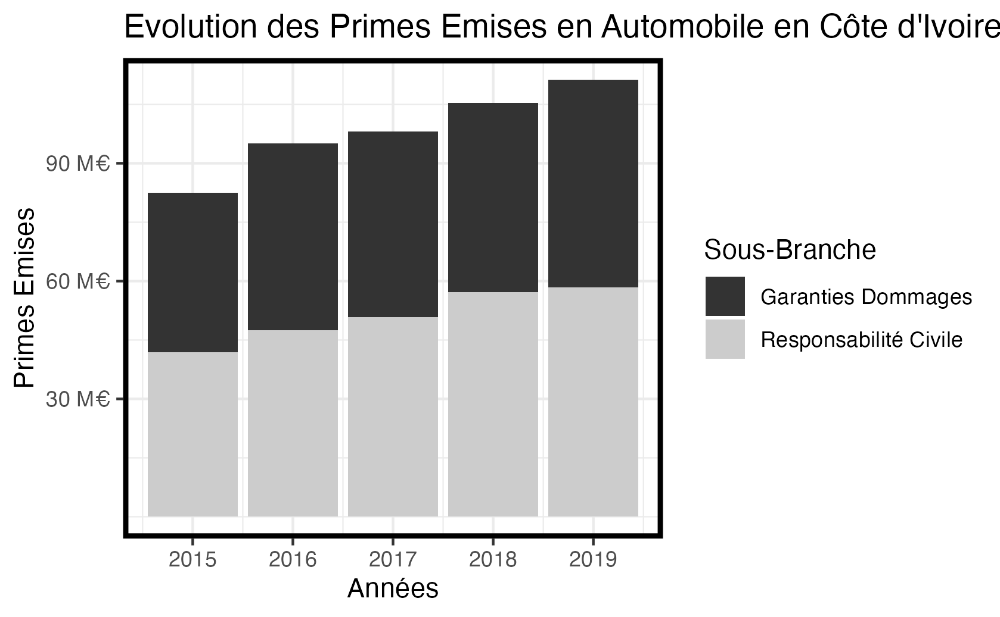
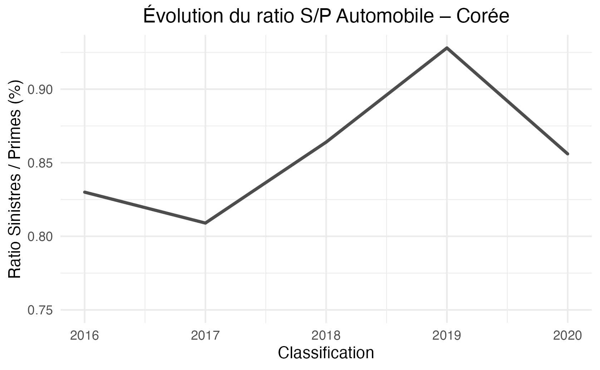
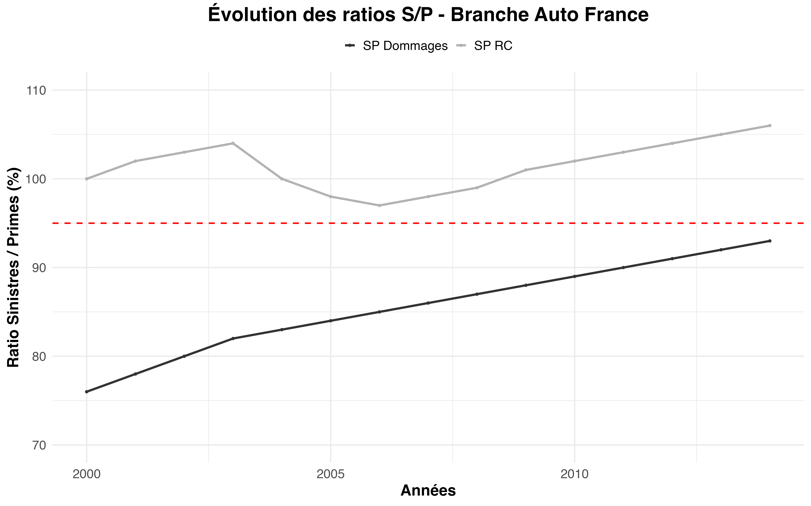
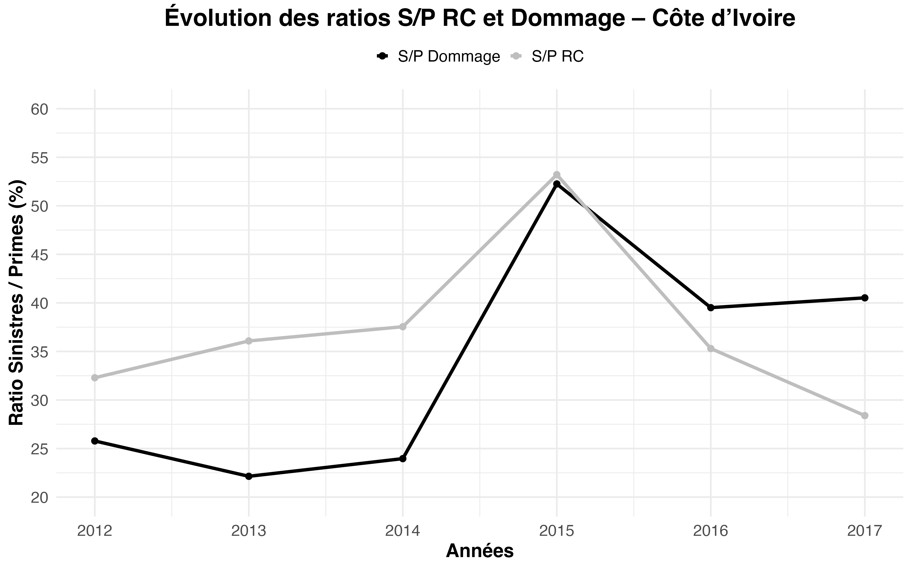
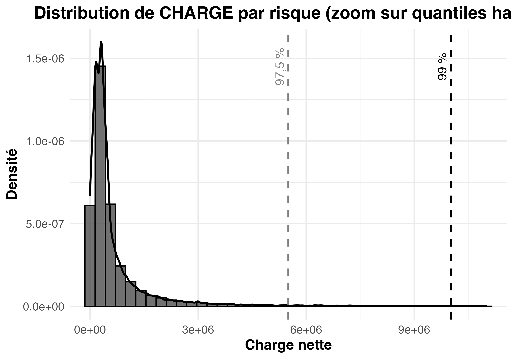

# Pricing RC Automobile – Revue du tarif réglementaire en Côte d'Ivoire

> Projet de recherche du **Club Actuariat Recherche CIMA** : évaluer, près de vingt ans après son introduction, la pertinence du tarif réglementaire minimum de l'assurance responsabilité civile automobile, et proposer de nouveaux critères de tarification.


---

## Sommaire

1. [Contexte et objectifs](#contexte-et-objectifs)
2. [Méthodologie](#méthodologie)
3. [Aperçu des résultats](#aperçu-des-résultats)
4. [Structure du dépôt](#structure-du-dépôt)
5. [Accès aux données (DagsHub + DVC)](#accès-aux-données-dagshub--dvc)
6. [Installation et reproduction](#installation-et-reproduction)
7. [Article](#article)
8. [Contact et accès au projet](#contact-et-accès-au-projet)

---

## Contexte et objectifs

En Côte d'Ivoire, l'assurance responsabilité civile (RC) des véhicules terrestres à moteur est obligatoire. Dans le cadre du traité CIMA (1996), un **tarif minimum réglementaire** a été fixé par arrêté ministériel en **2003**. Il définit les critères et les modalités de calcul de la prime que tout propriétaire de véhicule doit souscrire.

L'assurance automobile est la première branche non vie du marché ivoirien (32 % des primes émises en 2021), et la RC en représente environ la moitié. Après quasiment 20 ans d'application, ce projet cherche à :

- **évaluer la pertinence** des critères du tarif réglementaire, notamment leur pouvoir discriminant ;
- **mesurer la capacité de la prime** à couvrir les sinistres au regard de l'inflation des coûts ;
- **proposer de nouveaux critères** de tarification ;
- **promouvoir l'usage des techniques actuarielles** dans les travaux de tarification.

C'est le premier d'une série de projets sur des thématiques actuarielles variées : l'organisation du dépôt sert de cadre commun aux projets suivants.

## Méthodologie

1. **Préparation des données** : traitement des valeurs aberrantes et manquantes, regroupement de modalités, traitement des sinistres extrêmes, détection d'anomalies (doublons, charges ou paiements négatifs, lignes sans flux).
2. **Analyse descriptive** : structure du portefeuille et sinistralité par usage du véhicule, zone géographique, type de moteur et puissance fiscale.
3. **Diagnostic statistique du tarif** : modèles linéaires généralisés (**GLM**) et **arbres de régression** pour mesurer le pouvoir discriminant des critères réglementaires.
4. **Nouvelles variables tarifaires** : ajout de variables supplémentaires puis comparaison des modèles.
5. **Résultats et recommandations**.

Les analyses sont réalisées sous **R**.

## Aperçu des résultats

Quelques-uns des graphiques produits (dossier [`Results/`](Results/)) :

| Primes émises en automobile (Côte d'Ivoire) | Distribution de la charge de sinistres |
|:---:|:---:|
|  |  |

| Ratio S/P automobile – Corée | Ratio S/P automobile – France |
|:---:|:---:|
|  |  |

| Ratios S/P RC et Dommage – Côte d'Ivoire | Distribution de la charge nette |
|:---:|:---:|
|  |  |

## Structure du dépôt

```text
.
├── Data.dvc          # Pointeur DVC vers les données (stockées sur DagsHub)
├── Env/              # Environnement de travail (versions des logiciels et librairies)
├── Notebooks/        # Notebooks (Python, R, etc.)
├── Results/          # Graphiques, tableaux et article
│   └── Articles/     #   version de travail de l'article
└── Scripts/          # Scripts R ayant produit les analyses (contenu non publié)
```

Le dossier `Data/` n'est **pas versionné par Git** : il est géré par DVC (voir ci-dessous).

## Accès aux données (DagsHub + DVC)

Les données ne sont pas stockées dans Git. Elles sont suivies par [DVC](https://dvc.org) et hébergées sur DagsHub :

| | |
|---|---|
| **Dépôt DagsHub** | <https://dagshub.com/ClubActuariatRechercheCima/Pricing_motor3rdliab_civ_pub> |
| **Remote DVC** | `https://dagshub.com/ClubActuariatRechercheCima/Pricing_motor3rdliab_civ_pub.dvc` |
| **Branche** | `publication` |

Le fichier [`Data.dvc`](Data.dvc) contient l'empreinte (hash) du jeu de données de la version courante ; DVC s'en sert pour récupérer les bons fichiers.

### 1. Prérequis

- [Git](https://git-scm.com) ;
- [Python 3](https://www.python.org/downloads/) avec `pip` ;
- un compte [DagsHub](https://dagshub.com) disposant des droits de lecture sur le dépôt. Pour demander des droits, voir [Contact et accès au projet](#contact-et-accès-au-projet).

### 2. Installer DVC et DagsHub

Il est conseillé de les installer dans un environnement virtuel Python.

**Linux / macOS**

```bash
python3 -m venv .venv
source .venv/bin/activate
```

**Windows (PowerShell)**

```powershell
py -m venv .venv
.venv\Scripts\Activate.ps1
```

**Puis, sur tous les systèmes**

```bash
python -m pip install --upgrade pip
pip install --upgrade dvc dagshub

# Vérifier l'installation
dvc --version
dagshub --help
```

- **DVC** récupère les données correspondant au fichier `Data.dvc` (`dvc pull`).
- **DagsHub** fournit la commande `dagshub` (connexion, accès au bucket) et la bibliothèque Python.

Autres méthodes d'installation de DVC : [documentation officielle](https://dvc.org/doc/install). Sur Debian ou Ubuntu, `python3 -m venv` peut nécessiter le paquet `python3-venv`.

Le dossier `.venv/` est ignoré par Git.

### 3. Récupérer le projet et les données

```bash
git clone https://github.com/ClubActuariatRechercheCima/Pricing_motor3rdliab_civ_pub.git
cd Pricing_motor3rdliab_civ_pub
git checkout publication

# Authentification DagsHub (à stocker en local, jamais dans Git)
dvc remote modify --local dagshub auth basic
dvc remote modify --local dagshub user <votre_nom_utilisateur_dagshub>
dvc remote modify --local dagshub password <votre_token_dagshub>

# Téléchargement des données dans Data/
dvc pull
```

Le token d'accès se génère dans DagsHub, sous *Paramètres* → *Tokens*. L'option `--local` l'enregistre dans `.dvc/config.local`, un fichier ignoré par Git.

### 4. Vérifier que tout est synchronisé

```bash
dvc status -c      # doit afficher : Cache and remote 'dagshub' are in sync.
```

### Autre méthode : le bucket DagsHub Storage

Une copie des données est aussi disponible dans le bucket du dépôt (DagsHub Storage), sous `Data/`. Depuis la racine du projet :

```bash
# DagsHub doit être installé (voir « Installer DVC et DagsHub »)
dagshub login
dagshub download --bucket ClubActuariatRechercheCima/Pricing_motor3rdliab_civ_pub Data Data
```

Le bucket n'est pas versionné avec les branches Git. Pour obtenir la version des données qui correspond à un commit, utilisez `dvc pull`.

### Accès depuis Python

```python
import dagshub
dagshub.init(repo_owner="ClubActuariatRechercheCima",
             repo_name="Pricing_motor3rdliab_civ_pub", mlflow=False)
```

> **Important :** ne jamais ajouter de clés d'accès ou de mots de passe dans `.dvc/config` (versionné). Utiliser toujours `--local`.

## Installation et reproduction

1. Récupérer le code et les données (voir la section précédente).
2. Consulter les versions utilisées dans [`Env/`](Env/) :
   - `Requirements.txt` : librairies et leurs versions ;
   - `Software_version.txt` : versions des logiciels.
3. Les scripts R (`Scripts/`) ne sont pas publiés dans ce dépôt public : voir [Contact et accès au projet](#contact-et-accès-au-projet) pour les obtenir.

## Article

- **Article** : *Revue du tarif réglementaire en assurance responsabilité civile automobile en Côte d'Ivoire*, Yoboua Angoua. Version de travail du 25 mai 2022 : [`Results/Articles/YA-Version du 25 Mai.pdf`](Results/Articles/YA-Version%20du%2025%20Mai.pdf).

## Contact et accès au projet

Ce dépôt est une **version publique en lecture seule** du projet. Le développement se déroule dans un dépôt privé : les contributions ne sont pas reçues via ce dépôt (pas de *pull request*).

Pour contribuer, obtenir l'accès aux données ou demander à être ajouté au projet privé, contactez la structure porteuse du projet :

- **Club Actuariat Recherche CIMA** : <https://github.com/ClubActuariatRechercheCima>
- Pour les droits sur les données, indiquez votre nom d'utilisateur **DagsHub** dans votre demande.

---

*Projet porté par le Club Actuariat Recherche CIMA.*
